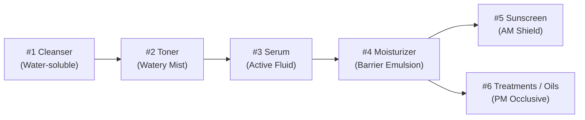

# Skin Diary 🧴✨
### *A Luxury Mindful Skincare Companion & Dermatological Habit Tracker*

<div align="center">


<br/>

**Skin Diary** is an offline-first mobile application designed to transform skincare from an overwhelming task into a mindful daily ritual. Built with **React Native**, **Expo**, and **TypeScript**, it combines dermatological application science, algorithmic product ordering, dynamic routine tracking, emoji-based skin reflection, and a warm luxury aesthetic.

</div>

---

## 📖 Table of Contents
- [Executive Summary](#-executive-summary)
- [Design Philosophy & Luxury Visual Identity](#-design-philosophy--luxury-visual-identity)
- [Feature Walkthrough](#-feature-walkthrough)
  - [1. 3-Step Swipeable Onboarding](#1--3-step-swipeable-onboarding)
  - [2. Digital Product Cabinet & Sorting Algorithm](#2--digital-product-cabinet--sorting-algorithm)
  - [3. Time-Aware AM/PM Routine Checklist](#3--time-aware-ampm-routine-checklist)
  - [4. Skin Diary & Dynamic Smart Tips](#4--skin-diary--dynamic-smart-tips)
  - [5. Calendar History & Streak Gamification](#5--calendar-history--streak-gamification)
  - [6. Authentication & Custom Profile Studio](#6--authentication--custom-profile-studio)
  - [7. Bilingual Localization (EN / TR)](#7--bilingual-localization-en--tr)
- [Application Ordering Logic](#-application-ordering-logic)
- [Technical Architecture & State Management](#-technical-architecture--state-management)
- [Data Storage Schema](#-data-storage-schema-asyncstorage)
- [Upcoming Cloud Integration (Firebase Roadmap)](#-upcoming-cloud-integration-firebase-roadmap)
- [Project Directory Structure](#-project-directory-structure)
- [Getting Started & Local Development](#-getting-started--local-development)
- [Academic Information & Credits](#-academic-information--credits)

---

## 🌟 Executive Summary

In modern skincare, consumers frequently manage dozens of active ingredients (AHAs, BHAs, retinoids, vitamin C, hyaluronic acid, peptides, ceramides). Applying these products in the incorrect sequence severely inhibits molecular absorption, causes ingredient pilling, and risks disrupting the delicate epidermal skin barrier.

**Skin Diary** addresses this gap by bridging **dermatological application science** with **habit formation engineering**:

1. **Algorithmic Organization:** Automatically sorts every cosmetic in the user's cabinet from **thinnest viscosity to thickest occlusion**.
2. **Context-Aware Routine Guidance:** Intelligently switches between dedicated **Morning (AM)** and **Evening (PM)** workflows based on the device's clock.
3. **Frictionless Daily Logging:** Replaces tedious text journals with quick, intuitive **emoji check-ins** coupled with tailored, dermatologically backed **Smart Tips**.
4. **Visual Consistency Tracking:** Motivates long-term skincare adherence with an interactive calendar strip featuring historical skin badges and habit streak counters.
5. **Private & Local-First:** Protects personal wellness data through instantaneous, offline-ready local persistence.

---

## 🎨 Design Philosophy & Luxury Visual Identity

The visual language of **Skin Diary** draws inspiration from high-end apothecary packaging, minimalist Japanese skincare sanctuaries, and contemporary editorial typography.

```
       #BEA68C              #FAF8F5              #C86D56              #709775              #262422
  [  Warm Sand  ]      [  Rich Cream  ]     [ Warm Terracotta ]      [ Calming Sage ]     [ Deep Charcoal ]
    Hero Ambient          Canvas / Card         Primary Accent       Secondary Accent        Typography
```

### 1. Warm Sand & Cream Color Harmony
- **Background (`#FAF8F5`):** A soft, calming warm cream that reduces optical fatigue compared to sterile white.
- **Ambient Sand (`#BEA68C`):** The signature brand tone framing splash screens, medallions, and badge backgrounds.
- **Warm Terracotta (`#C86D56`):** Used for primary CTAs, active status indicators, and notification badges.
- **Calming Sage (`#709775`):** Represents botanical nourishment; used for completed checkboxes, AM routines, and progress feedback.
- **Deep Charcoal (`#262422`):** Grounded typography with high legibility and luxury contrast ratios.

### 2. 3D Pearlescent Lotus Blossom Brand Asset
- The app icon and splash screen feature a bespoke **3D shaded white lotus flower** resting on a warm sand gradient background.
- Symbolizing purity, renewal, and mindful self-care, the lotus asset anchors both the **App Icon**, the **Native Splash Screen** (`resizeMode: "contain"`), and the **Hero Headers** of the authentication screens.

### 3. Comprehensive Dark Theme Adaptation
- Rather than a harsh pure black, the Dark Mode employs a rich obsidian palette (`#121212` background, `#1E1E1E` card surfaces).
- Text smoothly transitions to soft ivory (`#FAF8F5`) and warm light sand (`#EAE6E1`), preserving perfect contrast and luxury elegance in low-light environments.

---

## 📱 Feature Walkthrough

### 1. 🌿 3-Step Swipeable Onboarding
A welcoming, distraction-free introductory experience for first-time users before entering the application:
- **Horizontal Paging:** Built with an optimized `FlatList` (`pagingEnabled`, fixed `Dimensions.get('window').width`) guaranteeing 60fps swipe gestures without content cutoff.
- **Bespoke Medallion Badges:** Outline vector icons from `@expo/vector-icons` (`Ionicons`) enclosed within dual concentric circular frames:
  - **Step 1 (`layers-outline`):** *Digital Cabinet* — Explains automated viscosity ordering.
  - **Step 2 (`checkmark-done-circle-outline`):** *Track Routines* — Details AM/PM routine completion.
  - **Step 3 (`sparkles-outline`):** *Skin Diary* — Introduces emoji logging and habit tracking.
- **Interactive Controls:** Dynamic pagination pills (active dot expands into a terracotta/sage capsule), top-right **Skip** shortcut, and a prominent **Get Started →** button on the final slide.

### 2. 🧴 Digital Product Cabinet & Sorting Algorithm
The central inventory hub for all skincare products:
- **Intelligent Sorting Hierarchy:** Arranges all saved products from **thinnest formulation to thickest occlusion** (Cleanser → Toner → Serum → Moisturizer → Sunscreen → Masks/Oils).
- **Period-After-Opening (PAO) Tracker:** Logs the exact date each product was opened (`Opened Date`) and formats it in a subtle badge (e.g., `Açılış: 4 Kas 2026`), assisting users in monitoring cosmetic shelf-life and active ingredient degradation.
- **Quick Category Filtering:** Horizontal filter pills (`All`, `Cleanser`, `Toner`, `Serum`, `Moisturizer`, `Sunscreen`, `Masks`) allow instant sorting and isolation of specific ritual steps.
- **Modal Addition Form:** Clean bottom-sheet modal for registering new items with product name, optional brand, category order badges (`#1` through `#7`), and a single-tap `Set to Today` button for open dates.

### 3. ☀️/🌙 Time-Aware AM/PM Routine Checklist
A dedicated checklist guiding users through their morning and evening applications:
- **Automatic Time Detection:** Automatically defaults to the **Morning Routine (AM)** between 05:00 AM and 04:59 PM, and shifts to the **Evening Routine (PM)** from 05:00 PM onwards.
- **Real-Time Progress Meter:** Displays completed step ratios (e.g., `4 / 5 steps completed`) accompanied by a live percentage bar.
- **Tactile Interaction:** Smooth checkbox toggles with subtle strikethrough feedback and state opacity adjustments.
- **Ritual Completion Gate:** The primary action button remains locked until all steps are marked, unlocking as `✨ Routine Completed! Log Skin` and routing the user directly into the Diary for post-routine reflection.

### 4. ✨ Skin Diary & Dynamic Smart Tips
Enables users to evaluate daily skincare efficacy and log skin barrier status in seconds:
- **5 Distinct Emoji Reflection States:**
  - ✨ **Glowing (`Işıltılı`):** Radiant, calm barrier.
  - 💧 **Hydrated (`Nemli`):** Plump, balanced moisture retention.
  - 🏜️ **Dry (`Kuru`):** Dehydrated, tight, or flaky skin.
  - 🌸 **Sensitive (`Hassas`):** Reactive, reddened, or sensitized barrier.
  - 🩹 **Breakout (`Sivilce / Akne`):** Active blemishes, congestion, or pimple patches.
- **Contextual Smart Skincare Tips:** Selecting any skin condition instantly generates dynamic dermatological guidance, providing:
  - *Dermatological Diagnosis Title* (e.g., *Barrier Recovery Mode*, *Deep Hydration Rescue*).
  - *Scientific Explanation* (e.g., lipid deficiencies, water loss, sun protection).
  - *Immediate Action Step* (e.g., layer ceramide cream, avoid harsh exfoliants).
- **Journaling Note Field:** Optional open text input for capturing external variables (e.g., new cosmetic trial, hormonal cycle, climate).

### 5. 📅 Calendar History & Streak Gamification
Visualizing historical skincare data to reinforce daily consistency:
- **Current-Date Centered Strip:** A horizontal calendar strip that automatically highlights and centers on today's date.
- **Saved Mini-Emoji Badges:** Displays the exact logged condition emoji as a discreet icon directly below historical dates.
- **Interactive Archive Inspection:** Tapping any past date with an indicator opens a card revealing the historical condition, journal note, and specific Smart Tip issued on that day.
- **Record Management:** Full chronological history feed with individual entry deletion capabilities.

### 6. 👤 Authentication & Custom Profile Studio
A complete authentication and identity workflow:
- **Minimalist Auth Screens:** Elegant `LoginScreen` and `SignUpScreen` with the 3D lotus emblem, smooth password reveal/hide toggles, validation banners, and a single-tap **Quick Demo Sign-In (Zeynep)** for seamless testing.
- **Profile Studio (`SettingsScreen`):**
  - **Editable Profile Name:** Real-time dirty-state tracking with an `Unsaved` badge and save button.
  - **Camera & Gallery Photo Upload:** Integrated with `expo-image-picker` (`launchCameraAsync`, `launchImageLibraryAsync`) with graceful permission handling.
  - **Aesthetic Avatar Library:** Direct selection from 8 curated minimalist avatars:
    - 🌿 *Botanical* | ✨ *Radiance* | 🌸 *Blossom* | 🧸 *Cozy Bear*
    - 🫧 *Gentle Mist* | 🍵 *Matcha Tea* | 🍯 *Honey Glow* | 🥑 *Nourish*
  - **Reactive Header Bubble:** The global navigation bar instantly reflects the uploaded photo, chosen avatar, or user initial.

### 7. 🌐 Bilingual Localization (EN / TR)
Full internationalization supporting global and domestic users:
- **Instant Language Toggle:** Easily switch between 🇬🇧 **English** and 🇹🇷 **Turkish** inside the Settings menu.
- **Comprehensive String Coverage:** Over 200 localized keys covering all buttons, placeholders, validation alerts, calendar months, days of the week, and dermatological tips.
- **Strict Brand Rule Enforcement:** The trademark brand name **`Skin Diary`** is strictly preserved in its original form across all locales and headers.

---

## 📐 Application Ordering Logic

Applying skincare products out of sequence impedes water-soluble penetration and compromises active ingredient efficacy. **Skin Diary** enforces standard dermatological ordering based on physical formulation density:



| Step Order | Category | Typical Consistency | Primary Routine | Function in Regimen |
| :---: | :--- | :--- | :---: | :--- |
| **#1** | **Cleanser** | Gel / Foam / Milk | AM & PM | Clears impurities and excess sebum without stripping the barrier. |
| **#2** | **Toner** | Liquid Mist / Essence | AM & PM | Restores physiological skin pH (5.5) and delivers initial humectants. |
| **#3** | **Serum** | Fluid / Active Concentrate | AM & PM | Targeted delivery of concentrated actives (Niacinamide, HA, Vitamin C). |
| **#4** | **Moisturizer** | Emulsion / Barrier Cream | AM & PM | Lipids and ceramides that lock in moisture and reinforce stratum corneum. |
| **#5** | **Sunscreen** | Fluid / Chemical / Mineral | **AM Only** | Broad-spectrum UV defense; mandatory final step in every morning ritual. |
| **#6** | **Masks & Treatments** | Intensive Gel / Sheet / Balm | PM (1–3x weekly) | Deep hydration, exfoliation (AHA/BHA), or overnight recovery. |
| **#7** | **Facial Oil** | 100% Lipid / Squalane | PM Only | Occlusive seal preventing transepidermal water loss (TEWL) during sleep. |

---

## 🛠 Technical Architecture & State Management

```
┌────────────────────────────────────────────────────────┐
│                   React Native Application             │
├────────────────────────────────────────────────────────┤
│  Navigation Layer (React Navigation 7)                 │
│  ├── Auth Stack: Onboarding → Login → SignUp           │
│  └── Main Stack: Routine ╪ Cabinet ╪ Diary ╪ Settings  │
├────────────────────────────────────────────────────────┤
│  Context & State Management Architecture               │
│  ├── ThemeContext    : Dark Mode / Light Cream Palette │
│  ├── LanguageContext : Reactive English / Turkish i18n │
│  └── AuthContext     : Session token & Profile State   │
├────────────────────────────────────────────────────────┤
│  Local Persistence Services (AsyncStorage)             │
│  ├── @skin_diary_products : Viscosity-sorted inventory │
│  ├── @skin_diary_logs     : Date-indexed skin entries  │
│  └── @skin_diary_user     : Authenticated profile info │
└────────────────────────────────────────────────────────┘
```

### Architectural Decisions
- **TypeScript First:** Strict typings (`Product`, `SkinLog`, `UserProfile`, `TranslationKey`) prevent runtime defects and enforce dictionary key validity at compile time.
- **Offline-First Resilience:** Zero reliance on remote servers for core functions; the entire user experience runs smoothly in airplane mode with sub-millisecond local reads.
- **Reactive Localization & Theming:** Custom React Context hooks (`useTheme`, `useLanguage`) trigger instant component re-renders upon toggling themes or languages without reloading the app bundle.
- **Modular Services:** All storage operations (`getProducts`, `addProduct`, `deleteProduct`, `getLogs`, `saveLog`) are decoupled into standalone service files for straightforward testability and future cloud migrations.

---

## 💾 Data Storage Schema (AsyncStorage)

User data is persisted on-device using `@react-native-async-storage/async-storage`:

```typescript
// Key: '@skin_diary_products'
export interface Product {
  id: string;               // Unique UUID v4
  name: string;             // e.g., "10% Niacinamide Serum"
  brand?: string;           // e.g., "The Ordinary"
  category: ProductCategory;// 'cleanser' | 'toner' | 'serum' | 'moisturizer' | 'sunscreen' | 'masks_treatments' | 'facial_oil'
  openedDate: string;       // ISO Date: 'YYYY-MM-DD'
  orderWeight: number;      // Dermatological hierarchy weight (1 to 7)
}

// Key: '@skin_diary_skin_logs'
export interface SkinLog {
  id: string;               // Unique timestamp/UUID
  date: string;             // ISO Date: 'YYYY-MM-DD'
  condition: SkinCondition; // 'glowing' | 'hydrated' | 'dry' | 'sensitive' | 'breakout'
  note?: string;            // User journal reflection
  smartTip: {
    title: string;          // e.g., "Barrier Recovery Mode"
    description: string;    // Contextual skin advice
    action: string;         // Actionable suggestion
  };
}

// Key: '@skin_diary_auth_user'
export interface UserProfile {
  id: string;               // User identifier
  name: string;             // Display name
  email: string;            // User email
  photoUri?: string;        // Local file URI or 'avatar:🌸'
}
```

---

## ☁️ Upcoming Cloud Integration (Firebase Roadmap)

While **Skin Diary** currently operates with full offline persistence via `AsyncStorage`, the technical architecture is specifically structured for a smooth migration to **Google Firebase** in the next phase:

```
[ Local AsyncStorage Layer ]  ──►  [ Cloud Firestore Sync ]  ──►  [ Multi-Device Experience ]
```

1. **Firebase Authentication:** Replace mock storage auth with secure Firebase Auth (Email/Password, Google Sign-In, Apple ID).
2. **Cloud Firestore:** Real-time two-way synchronization of the Digital Cabinet and Skin Logs across multiple iOS and Android devices.
3. **Firebase Cloud Storage:** Cloud hosting for user profile photos uploaded via the camera and media library.
4. **Cloud Functions & Push Notifications:** Automated morning and evening skincare ritual reminders tailored to the user's localized timezone.

---

## 📂 Project Directory Structure

```bash
Mobile-App-Development/
├── App.tsx                      # Root component configuring providers & theme wrappers
├── app.json                     # Expo configuration (lotus splash, #BEA68C background)
├── package.json                 # Project dependencies & scripts
├── tsconfig.json                # TypeScript compiler configuration
├── assets/                      # Application brand assets
│   ├── icon.png                 # 3D lotus app icon (527x527)
│   ├── splash.png               # Luxury splash screen asset
│   └── favicon.png              # Web favicon
└── src/
    ├── components/              # Shared UI components
    │   └── ThemeToggle.tsx      # Reusable minimalist Dark/Light mode toggle button
    ├── constants/               # Design tokens & translations
    │   ├── theme.ts             # Palette (cream, sand, terracotta, sage), typography, spacing
    │   └── translations.ts      # EN & TR translation dictionaries (200+ keys)
    ├── context/                 # Application state providers
    │   ├── AuthContext.tsx      # User authentication & profile persistence
    │   ├── LanguageContext.tsx  # Reactive bilingual locale switcher
    │   └── ThemeContext.tsx     # Light/Dark mode state management
    ├── navigation/              # React Navigation hierarchies
    │   ├── AuthNavigator.tsx    # Stack: Onboarding → Login → SignUp
    │   ├── MainNavigator.tsx    # Stack modal wrapper: MainTabs ╪ Settings
    │   └── TabNavigator.tsx     # Bottom Tabs: Routine | Cabinet | Diary
    ├── screens/                 # Core application views
    │   ├── OnboardingScreen.tsx # 3-step swipable introduction with Ionicons badges
    │   ├── LoginScreen.tsx      # Luxury sign-in with lotus hero & demo fill
    │   ├── SignUpScreen.tsx     # Account registration view
    │   ├── RoutineScreen.tsx    # Time-aware AM/PM checklist & live progress bar
    │   ├── CabinetScreen.tsx    # Viscosity-sorted product cabinet & PAO tracker
    │   ├── DiaryScreen.tsx      # Emoji check-in, Smart Tips & calendar history
    │   └── SettingsScreen.tsx   # Avatar picker studio, language switch & logout
    ├── services/                # Local data storage abstraction
    │   ├── productStorage.ts    # AsyncStorage CRUD for skincare products
    │   └── skinLogStorage.ts    # AsyncStorage CRUD for daily diary logs
    └── types/                   # TypeScript interfaces & definitions
        ├── navigation.ts        # Param lists for Auth, Main, and Tab stacks
        └── product.ts           # Product, category, and skin log interfaces
```

---

## 🚀 Getting Started & Local Development

### Prerequisites
- [Node.js](https://nodejs.org/) (v18.0 or later recommended)
- [npm](https://www.npmjs.com/) or [yarn](https://yarnpkg.com/)
- [Expo Go](https://expo.dev/client) app installed on your physical iOS or Android device (optional for hardware testing)

### Installation

1. **Clone the Repository:**
   ```bash
   git clone https://github.com/zhevadpal-dev/Mobile-App-Development-.git
   cd Mobile-App-Development-
   ```

2. **Install Dependencies:**
   ```bash
   npm install
   ```

3. **Verify Type Checking:**
   ```bash
   npx tsc --noEmit
   ```

4. **Launch the Development Server:**
   ```bash
   npx expo start
   ```

5. **Run on Simulators or Physical Hardware:**
   - Press `i` to open the **iOS Simulator**.
   - Press `a` to open the **Android Emulator**.
   - Scan the terminal QR code with your iPhone Camera (iOS) or the **Expo Go** app (Android) to test on a physical device.

---

## 🎓 Academic Information & Credits

This mobile application was engineered as a comprehensive term project for the **Management Information Systems (MIS)** Mobile Application Development curriculum.

- **Project Title:** Skin Diary — Mobile Skincare Habit Tracker & Digital Cabinet
- **Platform:** React Native (Expo SDK 58, TypeScript)
- **Architecture:** Offline-First Modular Component Architecture
- **Primary Investigator / Developer:** Zeynep Naz Hevadpal
- **Term:** 2026 Academic Year

---

<div align="center">

*Skin Diary • Mindful Skincare Rituals & Algorithmic Habit Formation* 🌿✨

</div>
