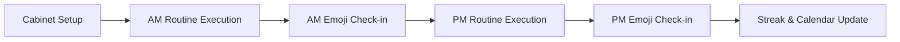
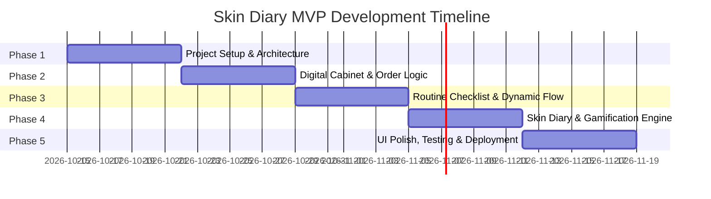

# Skin Diary 🧴✨

A modern, intuitive mobile application built with **React Native** and **Expo** that helps users organize their skincare products, follow guided morning and evening routines in the correct application order, log daily skin conditions, and build long-lasting skincare habits.

---

## 📖 Table of Contents
- [Project Overview](#-project-overview)
- [Tech Stack & Architecture](#-tech-stack--architecture)
- [MVP Core Features](#-mvp-core-features)
- [Application Order Logic](#-application-order-logic)
- [Sample Testing Scenario](#-sample-testing-scenario)
- [Data Storage Schema](#-data-storage-schema-asyncstorage)
- [5-Phase Project Development Plan](#-5-phase-project-development-plan)
- [Getting Started (Planned Workflow)](#-getting-started-planned-workflow)

---

## 🌟 Project Overview

Skincare routines can quickly become confusing when managing multiple active ingredients, formulations, and changing skin needs. Applying products in the wrong order can reduce efficacy or irritate the skin barrier.

**Skin Diary** solves this by functioning as a smart personal skincare assistant:
1. It automatically organizes your products from **thinnest to thickest** consistency.
2. It guides you through **Step-by-Step Morning and Evening Checklists**.
3. It lets you capture your skin's daily response using **quick emoji logs**.
4. It encourages consistency through a **weekly calendar tracker and streak counter**.

---

## 🛠 Tech Stack & Architecture

| Layer | Technology | Rationale |
| :--- | :--- | :--- |
| **Framework** | [React Native](https://reactnative.dev/) | Cross-platform native mobile application development using React. |
| **Tooling & Platform** | [Expo](https://expo.dev/) (Managed Workflow) | Rapid development cycle, streamlined asset handling, and easy device testing via Expo Go. |
| **Local Persistence** | [@react-native-async-storage/async-storage](https://react-native-async-storage.github.io/async-storage/) | Asynchronous, unencrypted, persistent key-value storage for offline-first user data (cabinets, routines, logs, streaks). |
| **Language** | JavaScript / TypeScript | Type-safe state management, predictable schemas, and modular code architecture. |
| **Icons & Styling** | Expo Vector Icons & React Native StyleSheet | Lightweight, native-feeling UI components optimized for iOS and Android. |

---

## 🎯 MVP Core Features

### 1. 🗄️ Digital Product Cabinet
- **Product Management:** Add, edit, and delete skincare products with details such as brand, product name, routine allocation (Morning, Evening, or Both), and category.
- **Categorization:** Supported categories include Cleanser, Toner, Essence/Exfoliant, Serum/Ampoule, Eye Cream, Moisturizer/Lotion, Facial Oil, and Sunscreen (SPF).
- **Automated Routine Sorting:** Products are dynamically sorted according to dermatological application principles—ordering them strictly from **thinnest consistency to thickest formulation**.

### 2. ✅ Step-by-Step Routine Checklist
- **Dual Routine Views:** Seamless switching between dedicated **Morning (AM)** and **Evening (PM)** routines.
- **Interactive Check-Off:** Interactive checkboxes allowing users to mark off each product one by one as they apply it.
- **Live Progress:** Visual progress bar tracking completion percentage for the current routine session.
- **Daily Reset:** Checklists reset daily so users start each morning and evening with a fresh routine.

### 3. 📝 Skin Diary (Post-Routine Logging)
- **Daily Skin Check-In:** Prompts the user upon completing a routine to record how their skin looks and feels.
- **Emoji-Based Reaction System:** Quick, frictionless logging using intuitive emojis:
  - ✨ **Glowing / Radiant:** Skin looks vibrant and healthy.
  - 💧 **Hydrated / Plump:** Optimal moisture balance, no tightness.
  - 🌵 **Dry / Flaky:** Skin feels tight, dehydrated, or rough.
  - 🍓 **Sensitive / Red:** Irritated skin, burning sensation, or erythema.
  - ⚡ **Breakout / Congested:** Active blemishes, whiteheads, or clogged pores.
  - 🪞 **Oily / Greasy:** Excess sebum production throughout the day.
- **Quick Notes (Optional):** Short text input to record environmental factors (e.g., weather, new diet, stress).

### 4. 🔥 Consistency Tracker & Gamification
- **Streak Counter:** Tracks continuous days of completed skincare routines.
- **Weekly Calendar Strip:** At-a-glance visualization of the current week showing completed routine badges (AM badge, PM badge, or both).
- **Habit Reinforcement:** Visual milestones celebrating consistency (e.g., 3-day, 7-day, and 30-day milestone highlights).

---

## 📐 Application Order Logic

Skincare products must be applied in a specific sequence so that lighter, water-based formulations penetrate before heavier, occlusive layers seal them in. The app enforces the following default sorting hierarchy:

| Step Order | Category | Typical Consistency | Primary Routine |
| :---: | :--- | :--- | :---: |
| **1** | Cleanser / Oil Cleanser | Water-soluble / Rinse-off | AM & PM |
| **2** | Toner / Mist | Ultra-light liquid / Water | AM & PM |
| **3** | Essence | Watery lotion / Light viscosity | AM & PM |
| **4** | Serum / Ampoule | Lightweight active gel / Fluid | AM & PM |
| **5** | Eye Cream | Delicate cream / Targeted | AM & PM |
| **6** | Moisturizer / Cream | Emulsion / Barrier cream | AM & PM |
| **7** | Facial Oil | Rich lipid / Occlusive | PM (occasionally AM) |
| **8** | Sunscreen (SPF) | Protective barrier / Shield | **AM Only** |

> **Note:** Sunscreen is always placed as the final step of the Morning routine. Evening routines conclude at Moisturizer or Facial Oil.

---

## 🧪 Sample Testing Scenario

To validate real-world application flow, the following scenario outlines how a user with a **Normal Skin Profile** utilizes Skin Diary across a typical day.

### User Profile: Alex (Normal / Combination Skin)



#### Step 1: Initial Cabinet Configuration
Alex registers 6 staple products into their Digital Cabinet:
1. *Gentle Foaming Cleanser* (Category: Cleanser | Routine: AM & PM)
2. *Hydrating Rose Water Toner* (Category: Toner | Routine: AM & PM)
3. *10% Niacinamide Serum* (Category: Serum | Routine: AM & PM)
4. *Ceramide Barrier Cream* (Category: Moisturizer | Routine: AM & PM)
5. *Broad-Spectrum SPF 50 Fluid* (Category: Sunscreen | Routine: AM Only)
6. *Rosehip Seed Oil* (Category: Facial Oil | Routine: PM Only)

#### Step 2: Morning Routine (08:00 AM)
1. Alex opens the app and navigates to the **Morning Routine** tab.
2. The app presents the sorted checklist:
   - [x] Step 1: Gentle Foaming Cleanser
   - [x] Step 2: Hydrating Rose Water Toner
   - [x] Step 3: 10% Niacinamide Serum
   - [x] Step 4: Ceramide Barrier Cream
   - [x] Step 5: Broad-Spectrum SPF 50 Fluid *(automatically placed last)*
3. Alex ticks off each item in real time. The progress bar advances from 0% to 100%.
4. Upon tapping **"Complete Routine"**, a modal prompts for the skin status.
5. Alex selects 💧 **Hydrated** and saves the entry.

#### Step 3: Evening Routine (10:30 PM)
1. Alex opens the app and switches to the **Evening Routine** tab.
2. The app presents the sorted evening list:
   - [x] Step 1: Gentle Foaming Cleanser
   - [x] Step 2: Hydrating Rose Water Toner
   - [x] Step 3: 10% Niacinamide Serum
   - [x] Step 4: Ceramide Barrier Cream
   - [x] Step 5: Rosehip Seed Oil *(automatically placed after moisturizer)*
3. Alex checks off all 5 products.
4. Upon routine completion, Alex logs ✨ **Glowing** with note: *"Skin tolerated niacinamide well today"*.

#### Step 4: Verification of Tracker & Gamification
- **Streak Status:** Increments from `0 Days` to `1 Day`.
- **Calendar View:** Today's date displays dual check indicators (☀️ AM & 🌙 PM completed).
- **Data Integrity:** Restarting the application preserves the cabinet, logs, and streak counter via `AsyncStorage`.

---

## 💾 Data Storage Schema (AsyncStorage)

All user data is persisted locally on the device using `@react-native-async-storage/async-storage` via key-value records:

```typescript
// Key: '@skin_diary_products'
interface Product {
  id: string;               // UUID
  name: string;             // e.g., "10% Niacinamide Serum"
  brand: string;            // e.g., "The Ordinary"
  category: ProductCategory;// 'cleanser' | 'toner' | 'serum' | 'moisturizer' | 'oil' | 'sunscreen' ...
  routineType: 'am' | 'pm' | 'both';
  createdAt: number;
}

// Key: '@skin_diary_logs'
interface DailyLog {
  date: string;             // 'YYYY-MM-DD'
  amCompleted: boolean;
  pmCompleted: boolean;
  amEmoji?: string;         // '💧' | '✨' | '🌵' | '🍓' | '⚡' | '🪞'
  pmEmoji?: string;
  notes?: string;
}

// Key: '@skin_diary_streak'
interface StreakData {
  currentStreak: number;
  longestStreak: number;
  lastCompletedDate: string;// 'YYYY-MM-DD'
}
```

---

## 🗓️ 5-Phase Project Development Plan



### 🔹 Phase 1: Project Setup, Architecture & Navigation
- Initialize Expo project with React Native and TypeScript.
- Define application directory structure (`src/components`, `src/screens`, `src/services`, `src/types`, `src/constants`).
- Configure Bottom Tab Navigation:
  - 🏠 **Home / Today:** Daily Routine Checklist & Quick Log.
  - 🧴 **Cabinet:** Product inventory and sorting rules.
  - 📅 **Diary / History:** Calendar view, past logs, and streak tracker.
- Establish theme constants (color palette, typography, spacing).

### 🔹 Phase 2: Core Data Layer & Digital Cabinet
- Implement local persistence abstraction layer with `@react-native-async-storage/async-storage`.
- Build Product Management CRUD interface (Add Product modal, Edit, Delete).
- Implement the **Product Ordering Algorithm**:
  - Assign sorting weights to each skincare category.
  - Automatically order items from weight 1 (Cleanser) to weight 8 (Sunscreen/Oil).
- Filter products dynamically based on AM, PM, or Both flags.

### 🔹 Phase 3: Interactive Routine Checklist
- Build interactive Checklist UI for Morning and Evening routines.
- Implement checkbox state toggling with smooth visual feedback.
- Create real-time routine completion meter (0% to 100%).
- Add routine completion action button triggering the post-routine Skin Diary modal.
- Ensure daily state reset logic based on device date timestamp.

### 🔹 Phase 4: Skin Diary & Gamification Engine
- Build the post-routine **Emoji Check-in Modal** for quick skin state logging.
- Implement storage of daily logs indexed by ISO date (`YYYY-MM-DD`).
- Develop the **Streak Calculation Engine**:
  - Evaluate consecutive daily completions.
  - Prevent streak breaks if routine completed within 24-hour cycle.
- Build the **Weekly Calendar View**:
  - Highlight completed days with visual AM/PM badges.
  - Display past skin condition emojis on previous calendar days.

### 🔹 Phase 5: UI/UX Refinement, Testing & Final Documentation
- Polish visual design: responsive spacing, soft pastel aesthetic tailored for skincare applications, and tactile haptic feedback.
- Execute unit and manual testing against the **Sample Testing Scenario** (Normal skin profile).
- Test data persistence across app restarts, edge cases (e.g., missing products, skipped days).
- Finalize project documentation, user guide, and demo video preparation.

---

## 🚀 Getting Started (Planned Workflow)

*Note: Dependencies will be installed in Phase 1.*

```bash
# 1. Clone repository
git clone <repository-url>
cd Mobile-App-Development

# 2. Install dependencies (when Phase 1 begins)
npx create-expo-app@latest . --template blank-typescript
npx expo install @react-native-async-storage/async-storage @react-navigation/native @react-navigation/bottom-tabs

# 3. Start development server
npx expo start
```

---

## 👩‍💻 Author & Academic Attribution
- **Project:** Skin Diary Mobile Application
- **Coursework:** Final Project - Mobile Application Development
- **Frameworks:** React Native, Expo, AsyncStorage
