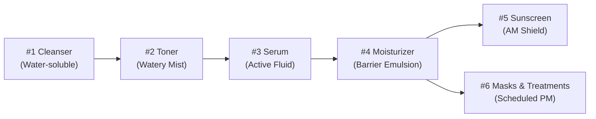

# Skin Diary 🧴✨
### *A Luxury Mindful Skincare Companion & Dermatological Habit Tracker*

<div align="center">


<br/>

**Skin Diary** is an offline-first mobile application designed to transform skincare from an overwhelming task into a mindful daily ritual. Built with **React Native**, **Expo**, and **TypeScript**, it combines dermatological application science, algorithmic product ordering, dynamic routine tracking, emoji-based skin reflection, and a warm luxury aesthetic.

</div>

---

## 📖 Table of Contents
- [Executive Summary](#-executive-summary)
- [Design Philosophy & Luxury Visual Identity](#-design-philosophy--luxury-visual-identity)
- [Feature Walkthrough](#-feature-walkthrough)
  - [1. 3-Step Swipeable Onboarding](#1--3-step-swipeable-onboarding)
  - [2. Advanced Digital Cabinet & Modular Camera Capture](#2--advanced-digital-cabinet--modular-camera-capture)
  - [3. Smart Mask Scheduling & Dynamic Due-Date Filtering](#3--smart-mask-scheduling--dynamic-due-date-filtering)
  - [4. Time-Aware AM/PM Routine & High-Contrast Controls](#4--time-aware-ampm-routine--high-contrast-controls)
  - [5. Daily Routine Affirmations & Mindful Ritual Closure](#5--daily-routine-affirmations--mindful-ritual-closure)
  - [6. Habit Streaks & Unlockable Milestones Showcase](#6--habit-streaks--unlockable-milestones-showcase)
  - [7. Skin Diary & Dynamic Smart Tips](#7--skin-diary--dynamic-smart-tips)
  - [8. Calendar History & Reflection Archive](#8--calendar-history--reflection-archive)
  - [9. Enhanced Profile Management & Global Avatar System](#9--enhanced-profile-management--global-avatar-system)
  - [10. Bilingual Localization (EN / TR)](#10--bilingual-localization-en--tr)
  - [11. Refined UI/UX & Dark Mode Aesthetics](#11--refined-uiux--dark-mode-aesthetics)
- [Application Ordering Logic](#-application-ordering-logic)
- [Technical Architecture & State Management](#-technical-architecture--state-management)
- [Data Storage Schema (AsyncStorage)](#-data-storage-schema-asyncstorage)
- [Upcoming Cloud Integration (Firebase Roadmap)](#-upcoming-cloud-integration-firebase-roadmap)
- [Project Directory Structure](#-project-directory-structure)
- [Getting Started & Local Development](#-getting-started--local-development)
- [Academic Information & Credits](#-academic-information--credits)

---

## 🌟 Executive Summary

In modern skincare, consumers frequently manage dozens of active ingredients (AHAs, BHAs, retinoids, vitamin C, hyaluronic acid, peptides, ceramides). Applying these products in the incorrect sequence severely inhibits molecular absorption, causes ingredient pilling, and risks disrupting the delicate epidermal skin barrier.

**Skin Diary** addresses this gap by bridging **dermatological application science** with **habit formation engineering**:

1. **Algorithmic Organization:** Automatically sorts every cosmetic in the user's cabinet from **thinnest viscosity to thickest occlusion**.
2. **Context-Aware Routine Guidance:** Intelligently switches between dedicated **Morning (AM)** and **Evening (PM)** workflows based on the device's clock.
3. **Smart Treatment Scheduling:** Automatically filters intensive masks and treatments so they only appear when actually due, respecting dermatological frequency and weekend preferences.
4. **Mindful Affirmations & Habit Streaks:** Celebrates daily routine completion with grounding affirmations and rewards long-term consistency with unlockable milestone badges.
5. **Frictionless Daily Logging:** Replaces tedious text journals with quick, intuitive **emoji check-ins** coupled with tailored, dermatologically backed **Smart Tips**.
6. **Private & Local-First:** Protects personal wellness data through instantaneous, offline-ready local persistence via `AsyncStorage`.

---

## 🎨 Design Philosophy & Luxury Visual Identity

The visual language of **Skin Diary** draws inspiration from high-end apothecary packaging, minimalist Japanese skincare sanctuaries, and contemporary editorial typography.

```
       #BEA68C              #FAF8F5              #C86D56              #709775              #262422
  [  Warm Sand  ]      [  Rich Cream  ]     [ Warm Terracotta ]      [ Calming Sage ]     [ Deep Charcoal ]
    Hero Ambient          Canvas / Card         Primary Accent       Secondary Accent        Typography
```

### 1. Warm Sand & Cream Color Harmony
- **Background (`#FAF8F5`):** A soft, calming warm cream that reduces optical fatigue compared to sterile white.
- **Ambient Sand (`#BEA68C`):** The signature brand tone framing splash screens, medallions, and badge backgrounds.
- **Warm Terracotta (`#C86D56`):** Used for primary CTAs, active status indicators, and notification badges.
- **Calming Sage (`#709775`):** Represents botanical nourishment; used for completed checkboxes, AM routines, and progress feedback.
- **Deep Charcoal (`#262422`):** Grounded typography with high legibility and luxury contrast ratios.

### 2. 3D Pearlescent Lotus Blossom Brand Asset
- The app icon and splash screen feature a bespoke **3D shaded white lotus flower** resting on a warm sand gradient background.
- Symbolizing purity, renewal, and mindful self-care, the lotus asset anchors both the **App Icon**, the **Native Splash Screen** (`resizeMode: "contain"`), and the **Hero Headers** of the authentication screens.

### 3. Elevated Dark Theme Adaptation
- Rather than a harsh pure black, the Dark Mode employs a rich obsidian palette (`#121211` background, `#1C1B19` card surfaces) with subtle borders.
- Active segmented controls highlight with elevated, tinted surfaces and delicate borders (terracotta-tinted for Morning, sage-tinted for Evening).
- Text smoothly transitions to soft ivory (`#FAF8F5`) and warm light sand (`#EAE6E1`), preserving perfect contrast and luxury elegance in low-light environments.

---

## 📱 Feature Walkthrough

### 1. 🌿 3-Step Swipeable Onboarding
A welcoming, distraction-free introductory experience for first-time users before entering the application:
- **Horizontal Paging:** Built with an optimized `FlatList` (`pagingEnabled`, fixed `Dimensions.get('window').width`) guaranteeing 60fps swipe gestures without content cutoff.
- **Bespoke Medallion Badges:** Outline vector icons from `@expo/vector-icons` (`Ionicons`) enclosed within dual concentric circular frames:
  - **Step 1 (`layers-outline`):** *Digital Cabinet* — Explains automated viscosity ordering.
  - **Step 2 (`checkmark-done-circle-outline`):** *Track Routines* — Details AM/PM routine completion.
  - **Step 3 (`sparkles-outline`):** *Skin Diary* — Introduces emoji logging and habit tracking.
- **Interactive Controls:** Dynamic pagination pills (active dot expands into a terracotta/sage capsule), top-right **Skip** shortcut, and a prominent **Get Started →** button on the final slide.

### 2. 🧴 Advanced Digital Cabinet & Modular Camera Capture
The central inventory hub for all skincare products, combining automated intelligence with manual control:
- **Modular Camera-to-Cabinet Flow:** Streamlined photo capture that eliminates arbitrary mock auto-saves. Right after capturing a product photo, the app opens a clean **Product Entry & Confirmation Modal** displaying the captured photo preview, allowing the user to review or input the Product Name, Brand, Category, Routine allocation, and Mask schedules before saving.
- **Vision API-Ready Architecture:** Designed with modular, decoupled helper functions so external AI endpoints (such as Google Cloud Vision API or custom OCR pipelines) can be seamlessly plugged in without rewriting UI or state management.
- **Manual Entry Fallback:** Clean modal with text inputs for product name, brand, category picker, and an optional image picker with an elegant category icon placeholder if no photo is taken.
- **Safely Nested Delete Workflow:** Removed cluttered delete triggers from product cards, nesting the delete action safely inside the Edit Product modal with a confirmation alert to prevent accidental removals.
- **Intelligent Sorting Hierarchy:** Arranges all saved cosmetics from **thinnest formulation to thickest occlusion** (Cleanser → Toner → Serum → Moisturizer → Sunscreen → Masks & Treatments).
- **Clean Card Architecture:** Circular thumbnail displays without overlapping step numbers, and the **Period-After-Opening (PAO)** date sits cleanly under the brand name as subtle text (e.g., `Açılış: 4 Kas 2026`).
- **Quick Category Filtering:** Horizontal filter pills (`All`, `Cleanser`, `Toner`, `Serum`, `Moisturizer`, `Sunscreen`, `Masks`) allow instant sorting and isolation of specific ritual steps.

### 3. 🧖‍♀️ Smart Mask Scheduling & Dynamic Due-Date Filtering
Intensive masks and treatments (sheet masks, clay peels, eye patches) should not be applied daily. **Skin Diary** introduces an intelligent scheduling engine:
- **Conditional Mask Configuration:** Selecting "Masks & Treatments" dynamically reveals a clean **Mask Schedule** configuration panel inside the product entry and edit modals.
- **Specialized Mask Types & Smart Auto-Filled Defaults:**
  - **Full Face / Sheet Mask (`🧖‍♀️ Tam Yüz Maskesi`):** Defaults to *Every 2 weeks*, *Weekends only*, *Evening*.
  - **Under-Eye Mask (`👀 Göz Altı Maskesi`):** Defaults to *Every 3 days*, *Any day*, *Evening*.
  - **Clay / Peel-Off Mask (`🧪 Kil / Soyulan Maske`):** Defaults to *Every 2 weeks*, *Any day*, *Evening*.
- **Full User Customization:** Users retain complete freedom to override frequency (*Every 3 days*, *Weekly*, *Every 2 weeks*, *Every 3 weeks*), day preference (*Any day*, *Weekends only*), and routine timing (*AM*, *PM*, *Both*).
- **Dynamic Due-Date Routine Filtering:** Masks do not clutter daily checklists unnecessarily; they are algorithmically filtered on the Routine Screen so they only appear when actually due (based on days elapsed since `lastCompletedDate` and day-of-week criteria).

### 4. ☀️/🌙 Time-Aware AM/PM Routine & High-Contrast Controls
A dedicated ritual checklist guiding users through their morning and evening applications:
- **High-Contrast Dark Mode Segmented Control:** Redesigned segmented routine switch with a recessed dark track (`#121211`), elevated pill tabs with crisp accent borders—warm terracotta (`rgba(217, 130, 107, 0.45)`) for Morning and calming sage (`rgba(134, 168, 146, 0.45)`) for Evening—guaranteeing immediate visual hierarchy in low light.
- **Automatic Time Detection:** Defaults to the **Morning Routine (AM)** between 05:00 AM and 04:59 PM, and shifts to the **Evening Routine (PM)** from 05:00 PM onwards.
- **Smart UV & Sun Protection Widget:** Minimalist contextual widget appearing exclusively during the Morning Routine with real-time UV index classifications, SPF 30+/50+ guidelines, and photo-damage prevention tips.
- **Clean Steps Header:** Streamlined steps list by removing redundant titles and counts, keeping the right-aligned `Rutini Düzenle` (`Edit Routine`) action button clean, balanced, and minimal.
- **Dynamic Cabinet Sync:** Products saved in the Digital Cabinet dynamically appear as checkable routine items in accordance with their assigned routine time.

### 5. ✨ Daily Routine Affirmations & Mindful Ritual Closure
Mindful skincare is an act of grounding self-care. Reaching 100% routine completion triggers a soothing affirmation experience:
- **Curated Skincare Affirmations:** Two distinct pools of sweet, grounding affirmations localized in English and Turkish:
  - **Morning Pool (Energizing & Fresh):** *"Your skin is prepped and glowing—have a radiant day!"*, *"A gentle morning ritual sets the tone for everything ahead."*, *"Protected, hydrated, and ready to shine."*
  - **Evening Pool (Calming & Restorative):** *"You washed the day away. Rest well and let your skin repair."*, *"Consistency is the purest form of self-love. Sweet dreams!"*, *"Your evening ritual is complete—time to unwind."*
- **Sleek Centered Modal:** Displays a centered luxury card with delicate quotation marks, ambient icon badge, the randomized affirmation quote, and a *"Glow On"* dismiss button or direct link to log skin condition.
- **Once-Per-Day Trigger Logic:** Persists `lastAffirmationDate` for Morning and Evening in `AsyncStorage`. Only triggers the first time the user reaches 100% completion for that routine on a given day, ensuring accidental unchecking and rechecking never spams pop-ups.

### 6. 🏆 Habit Streaks & Unlockable Milestones Showcase
Motivates consistent skincare habits through local streak computation and one-time milestone unlocks:
- **Consecutive Daily Streak Engine:** Analyzes completed routine dates in `AsyncStorage` to compute consecutive active streaks and best streaks, resilient against timezone shifts.
- **6 One-Time Unlockable Achievements:**
  - 🌱 **First Ritual (`İlk Ritüel`):** Completed very first skincare routine.
  - ✨ **3-Day Glow (`3 Günlük Işıltı`):** 3 consecutive days of mindful skincare rituals.
  - 🌿 **7-Day Devotion (`7 Günlük Bağlılık`):** Full week of consistent self-care.
  - 👑 **Glow Master (`Işıltı Ustası`):** 14 consecutive days of dedicated skincare practice.
  - 🧴 **Curated Shelf (`Küratör Dolap`):** Added 5 or more products to the Digital Cabinet.
  - 🧖‍♀️ **Self-Care Mask (`Maske Ritüeli`):** Completed a scheduled pampering mask step.
- **Strict One-Time Unlock Guarantee:** Verifies that a milestone ID does not already exist in `unlockedMilestones` before unlocking, ensuring badges and celebratory toasts trigger strictly once.
- **Celebratory Toast Banners:** Floating celebratory toast banners with terracotta accent borders and celebratory icons appear in real-time when unlocking milestones.
- **Profile Screen Showcase:** Centered 2-column luxury grid on Profile (`SettingsScreen.tsx`) highlighting current/longest streaks, unlocked dates, and locked hints.

### 7. 💧 Skin Diary & Dynamic Smart Tips
Enables users to evaluate daily skincare efficacy and log skin barrier status in seconds:
- **5 Distinct Emoji Reflection States:**
  - ✨ **Glowing (`Işıltılı`):** Radiant, calm barrier.
  - 💧 **Hydrated (`Nemli`):** Plump, balanced moisture retention.
  - 🏜️ **Dry (`Kuru`):** Dehydrated, tight, or flaky skin.
  - 🌸 **Sensitive (`Hassas`):** Reactive, reddened, or sensitized barrier.
  - 🩹 **Breakout (`Sivilce / Akne`):** Active blemishes, congestion, or pimple patches.
- **Contextual Smart Skincare Tips:** Selecting any skin condition instantly generates dynamic dermatological guidance, providing:
  - *Dermatological Diagnosis Title* (e.g., *Barrier Recovery Mode*, *Deep Hydration Rescue*).
  - *Scientific Explanation* (e.g., lipid deficiencies, water loss, sun protection).
  - *Immediate Action Step* (e.g., layer ceramide cream, avoid harsh exfoliants).
- **Decluttered Header:** Simplified subtitle to concise *"Cilt bakım rutini"* / *"Skincare routine"* and removed redundant placeholder helper boxes below the calendar strip.
- **Journaling Note Field:** Optional open text input for capturing external variables (e.g., new cosmetic trial, hormonal cycle, climate).

### 8. 📅 Calendar History & Reflection Archive
Visualizing historical skincare data to reinforce daily consistency:
- **Current-Date Centered Strip:** A horizontal calendar strip that automatically highlights and centers on today's date.
- **Saved Mini-Emoji Badges:** Displays the exact logged condition emoji as a discreet icon directly below historical dates.
- **Interactive Archive Inspection:** Tapping any past date with an indicator opens a card revealing the historical condition, journal note, and specific Smart Tip issued on that day.
- **Record Management:** Full chronological history feed with individual entry deletion capabilities.

### 9. 👤 Enhanced Profile Management & Global Avatar System
A comprehensive authentication, identity, and customization studio:
- **Global Avatar System:** A unified customization modal allowing users to select cute animal avatars (🧸, 🐱, 🐼, 🐰, 🐶, 🦊) and pastel background colors (sage, cream, soft pink, lavender, peach), perfectly synced across the Home and Profile screens via global storage.
- **Enhanced Profile Management:** Native camera and gallery integration (`expo-image-picker`) for uploading real profile photos, integrated with a clean action menu (Take a Photo, Choose from Gallery, Choose Cute Avatar, Cancel).
- **State Priority Rendering:** Seamlessly displays the actual uploaded photo (`photoUri`) or falls back to the user's customized cute avatar and pastel background color.
- **Header Avatar Navigation:** Tapping the profile avatar on the HomeScreen header smoothly navigates directly to the full Profile and Settings studio.
- **Minimalist Auth Screens:** Elegant `LoginScreen` and `SignUpScreen` with the 3D lotus emblem, smooth password reveal/hide toggles, validation banners, and a single-tap **Quick Demo Sign-In (Zeynep)** for seamless testing.
- **Editable Profile Name:** Real-time dirty-state tracking with an `Unsaved` badge and save button.

### 10. 🌐 Bilingual Localization (EN / TR)
Full internationalization supporting global and domestic users:
- **Instant Language Toggle:** Easily switch between 🇬🇧 **English** and 🇹🇷 **Turkish** inside the Settings menu.
- **Comprehensive String Coverage:** Over 220 localized keys covering all buttons, placeholders, validation alerts, calendar months, days of the week, dermatological tips, routine affirmations, and milestone achievements.
- **Strict Brand Rule Enforcement:** The trademark brand name **`Skin Diary`** is strictly preserved in its original form across all locales and headers.

### 11. 🎨 Refined UI/UX & Dark Mode Aesthetics
- **High-Contrast Dark Mode Segmented Controls:** Deep recessed track (`#121211`) with clear terracotta/sage borders on active routine tabs.
- **Decluttered Headers:** Simplified DiaryScreen subtitle and streamlined RoutineScreen action button (`Rutini Düzenle`).
- **Clean Card Architecture:** Circular icon container without cluttering step numbers, subtle PAO opening date text, and safely nested delete actions with confirmation alerts.
- **Centered Modals:** Affirmation card sits centered (`width: '100%', maxWidth: 360, alignSelf: 'center'`) on all screen dimensions with an elegant dimmed backdrop.

---

## 📐 Application Ordering Logic

Applying skincare products out of sequence impedes water-soluble penetration and compromises active ingredient efficacy. **Skin Diary** enforces standard dermatological ordering based on physical formulation density:



| Step Order | Category | Typical Consistency | Primary Routine | Function in Regimen |
| :---: | :--- | :--- | :---: | :--- |
| **#1** | **Cleanser** | Gel / Foam / Milk | AM & PM | Clears impurities and excess sebum without stripping the barrier. |
| **#2** | **Toner** | Liquid Mist / Essence | AM & PM | Restores physiological skin pH (5.5) and delivers initial humectants. |
| **#3** | **Serum** | Fluid / Active Concentrate | AM & PM | Targeted delivery of concentrated actives (Niacinamide, HA, Vitamin C). |
| **#4** | **Moisturizer** | Emulsion / Barrier Cream | AM & PM | Lipids and ceramides that lock in moisture and reinforce stratum corneum. |
| **#5** | **Sunscreen** | Fluid / Chemical / Mineral | **AM Only** | Broad-spectrum UV defense; mandatory final step in every morning ritual. |
| **#6** | **Masks & Treatments** | Sheet / Clay / Eye Patches | **Scheduled (PM)** | Targeted recovery; dynamically scheduled every 3 days, weekly, or biweekly. |

---

## 🛠 Technical Architecture & State Management

```
┌────────────────────────────────────────────────────────┐
│                   React Native Application             │
├────────────────────────────────────────────────────────┤
│  Navigation Layer (React Navigation 7)                 │
│  ├── Auth Stack: Onboarding → Login → SignUp           │
│  └── Main Stack: Routine ╪ Cabinet ╪ Diary ╪ Settings  │
├────────────────────────────────────────────────────────┤
│  Context & State Management Architecture               │
│  ├── ThemeContext    : Dark Mode / Light Cream Palette │
│  ├── LanguageContext : Reactive English / Turkish i18n │
│  └── AuthContext     : Session token & Profile State   │
├────────────────────────────────────────────────────────┤
│  Local Persistence Services (AsyncStorage)             │
│  ├── @skin_diary_products   : Viscosity-sorted cabinet │
│  ├── @skin_diary_logs       : Date-indexed skin logs   │
│  ├── @skin_diary_milestones : Streaks & badge unlocks  │
│  ├── @skin_diary_completion : Daily routine checklists │
│  └── @skin_diary_auth_user  : Authenticated profile    │
└────────────────────────────────────────────────────────┘
```

### Architectural Decisions
- **TypeScript First:** Strict typings (`Product`, `SkinLog`, `UserProfile`, `MilestoneDefinition`, `TranslationKey`) prevent runtime defects and enforce key validity at compile time.
- **Offline-First Resilience:** Zero reliance on remote servers for core functions; the entire user experience runs smoothly in airplane mode with sub-millisecond local reads.
- **Reactive Localization & Theming:** Custom React Context hooks (`useTheme`, `useLanguage`) trigger instant component re-renders upon toggling themes or languages without reloading the app bundle.
- **Modular Services:** All storage operations (`productStorage`, `diaryStorage`, `milestoneService`, `authStorage`) are decoupled into standalone service files for straightforward testability and future cloud migrations.

---

## 💾 Data Storage Schema (AsyncStorage)

User data is persisted on-device using `@react-native-async-storage/async-storage`:

```typescript
// Key: '@skin_diary_products'
export interface Product {
  id: string;               // Unique UUID v4
  name: string;             // e.g., "10% Niacinamide Serum"
  brand?: string;           // e.g., "The Ordinary"
  category: ProductCategory;// 'cleanser' | 'toner' | 'serum' | 'moisturizer' | 'sunscreen' | 'masks_treatments'
  routineType?: RoutineType;// 'am' | 'pm' | 'both' | 'none'
  routineTime?: RoutineType;
  openedDate: string;       // ISO Date: 'YYYY-MM-DD'
  orderWeight: number;      // Dermatological hierarchy weight (1 to 6)
  imageUri?: string;        // Local photo URI from AI camera scan or gallery upload
  maskType?: MaskType;      // 'full_face' | 'under_eye' | 'clay_peel'
  frequency?: MaskFrequency;// 'every_3_days' | 'weekly' | 'every_2_weeks' | 'every_3_weeks'
  weekendsOnly?: boolean;   // Day preference filter for masks
  lastCompletedDate?: string;// Last completion date for mask interval calculation
}

// Key: '@skin_diary_milestones_data_v1'
export interface UserMilestonesData {
  completedDates: string[]; // ['2026-11-24', ...]
  currentStreak: number;    // Consecutive active days
  longestStreak: number;    // All-time best streak
  unlockedMilestones: Record<string, string>; // milestoneId -> unlockedAt ISO string
  lastRoutineCompletedAt?: string;
  lastAffirmationDate?: {
    morning?: string;       // 'YYYY-MM-DD'
    evening?: string;       // 'YYYY-MM-DD'
  };
}

// Key: '@skin_diary_skin_logs'
export interface SkinLog {
  id: string;               // Unique timestamp/UUID
  date: string;             // ISO Date: 'YYYY-MM-DD'
  condition: SkinCondition; // 'glowing' | 'hydrated' | 'dry' | 'sensitive' | 'breakout'
  note?: string;            // User journal reflection
  smartTip: {
    title: string;          // e.g., "Barrier Recovery Mode"
    description: string;    // Contextual skin advice
    action: string;         // Actionable suggestion
  };
}

// Key: '@skin_diary_auth_user'
export interface UserProfile {
  id: string;               // User identifier
  name: string;             // Display name
  email: string;            // User email
  photoUri?: string;        // Local file URI or undefined
  avatarEmoji?: string;     // Cute emoji avatar (🧸, 🐱, etc.)
  avatarBgColor?: string;   // Pastel background tone
}
```

---

## ☁️ Upcoming Cloud Integration (Firebase Roadmap)

While **Skin Diary** currently operates with full offline persistence via `AsyncStorage`, the technical architecture is specifically structured for a smooth migration to **Google Firebase** in the next phase:

```
[ Local AsyncStorage Layer ]  ──►  [ Cloud Firestore Sync ]  ──►  [ Multi-Device Experience ]
```

1. **Firebase Authentication:** Replace local mock auth with secure Firebase Auth (Email/Password, Google Sign-In, Apple ID).
2. **Cloud Firestore:** Real-time two-way synchronization of the Digital Cabinet, Milestones, and Skin Logs across multiple iOS and Android devices.
3. **Firebase Cloud Storage:** Cloud hosting for user profile photos and product thumbnails.
4. **Cloud Functions & Push Notifications:** Automated morning and evening skincare ritual reminders tailored to the user's localized timezone.

---

## 📂 Project Directory Structure

```bash
Mobile-App-Development/
├── App.tsx                      # Root component configuring providers & theme wrappers
├── app.json                     # Expo configuration (lotus splash, #BEA68C background)
├── package.json                 # Project dependencies & scripts
├── tsconfig.json                # TypeScript compiler configuration
├── assets/                      # Application brand assets
│   ├── icon.png                 # 3D lotus app icon (527x527)
│   ├── splash.png               # Luxury splash screen asset
│   └── favicon.png              # Web favicon
└── src/
    ├── components/              # Shared UI components
    │   └── AvatarPickerModal.tsx# Unified cute avatar & pastel color picker modal
    ├── constants/               # Design tokens & translations
    │   ├── theme.ts             # Palette (cream, sand, terracotta, sage), typography, spacing
    │   └── translations.ts      # EN & TR translation dictionaries (220+ keys)
    ├── context/                 # Application state providers
    │   ├── AuthContext.tsx      # User authentication & profile persistence
    │   ├── LanguageContext.tsx  # Reactive bilingual locale switcher
    │   └── ThemeContext.tsx     # Light/Dark mode state management
    ├── navigation/              # React Navigation hierarchies
    │   ├── AuthNavigator.tsx    # Stack: Onboarding → Login → SignUp
    │   └── TabNavigator.tsx     # Bottom Tabs: Home | Routine | Diary | Cabinet | Profile
    ├── screens/                 # Core application views
    │   ├── OnboardingScreen.tsx # 3-step swipable introduction with Ionicons badges
    │   ├── LoginScreen.tsx      # Luxury sign-in with lotus hero & demo fill
    │   ├── SignUpScreen.tsx     # Account registration view
    │   ├── HomeScreen.tsx       # Morning greeting, ritual CTA & quick shortcuts
    │   ├── RoutineScreen.tsx    # AM/PM checklist, UV widget & Affirmation modal
    │   ├── CabinetScreen.tsx    # AI product scan, mask scheduler & PAO tracker
    │   ├── DiaryScreen.tsx      # Emoji check-in, Smart Tips & calendar history
    │   └── SettingsScreen.tsx   # Profile studio, Milestones grid & language switch
    ├── services/                # Local data storage abstraction
    │   ├── productStorage.ts    # AsyncStorage CRUD for skincare products
    │   ├── diaryStorage.ts      # AsyncStorage CRUD for daily diary logs
    │   ├── milestoneService.ts  # Streak computation, milestone unlocks & affirmations
    │   └── authStorage.ts       # Local authentication & profile persistence
    └── types/                   # TypeScript interfaces & definitions
        ├── navigation.ts        # Param lists for Auth and Tab stacks
        ├── product.ts           # Product, category, mask schedule & routine types
        ├── diary.ts             # Skin log, condition and smart tip interfaces
        ├── milestone.ts         # Milestone definitions, streaks & affirmations
        └── auth.ts              # User profile and credentials interfaces
```

---

## 🚀 Getting Started & Local Development

### Prerequisites
- [Node.js](https://nodejs.org/) (v18.0 or later recommended)
- [npm](https://www.npmjs.com/) or [yarn](https://yarnpkg.com/)
- [Expo Go](https://expo.dev/client) app installed on your physical iOS or Android device (optional for hardware testing)

### Installation

1. **Clone the Repository:**
   ```bash
   git clone https://github.com/zhevadpal-dev/Mobile-App-Development-.git
   cd Mobile-App-Development-
   ```

2. **Install Dependencies:**
   ```bash
   npm install
   ```

3. **Verify Type Checking:**
   ```bash
   npx tsc --noEmit
   ```

4. **Launch the Development Server:**
   ```bash
   npx expo start
   ```

5. **Run on Simulators or Physical Hardware:**
   - Press `i` to open the **iOS Simulator**.
   - Press `a` to open the **Android Emulator**.
   - Scan the terminal QR code with your iPhone Camera (iOS) or the **Expo Go** app (Android) to test on a physical device.

---

## 🎓 Academic Information & Credits

This mobile application was engineered as a comprehensive term project for the **Management Information Systems (MIS)** Mobile Application Development curriculum.

- **Project Title:** Skin Diary — Mobile Skincare Habit Tracker & Digital Cabinet
- **Platform:** React Native (Expo SDK 58, TypeScript)
- **Architecture:** Offline-First Modular Component Architecture
- **Primary Investigator / Developer:** Zeynep Naz Hevadpal
- **Term:** 2026 Academic Year

---

<div align="center">

*Skin Diary • Mindful Skincare Rituals & Algorithmic Habit Formation* 🌿✨

</div>
